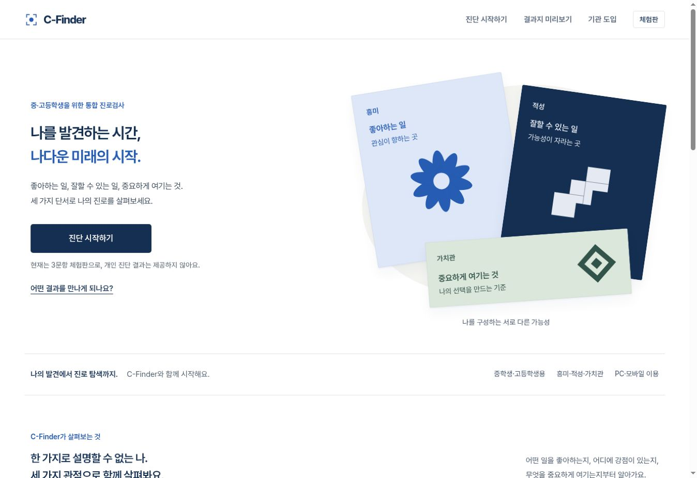

# C-Finder

흥미·적성·가치관을 함께 살펴보는 진로검사 서비스의 프런트엔드 뼈대입니다. **학생이 검사를 시작하고, 응답을 검토하고, 결과 화면까지 도달하는 흐름**을 먼저 구현했습니다. 개인용 서비스와 기관용 화면은 같은 검사 모듈을 사용합니다.

현재는 **체험판**입니다. 중학생용·고등학생용·대학생용에 각각 가상 문항 3개가 있으며, 공식 검사 문항·채점·개인 진로 유형은 연결하지 않았습니다.

**메인과 검사 화면의 디자인을 다시 정리했습니다.** 흥미·적성·가치관의 전용 그래픽, 실제 Pretendard 서체, 검사 선택과 응답 화면, 결과지·기관 소개에 같은 시각 기준을 적용했습니다. 이번 변경과 검증 범위는 [디자인 개선 기록](docs/design-refresh.md), 초기 구현 범위는 [1차 완료 보고](docs/phase1-review.md)에서 확인합니다.

공개 페이지: **https://jyhome1228-cyber.github.io/cfinder/**

## 별도 홍보페이지

교사·학부모를 위한 [C-Finder 홍보페이지](about/)를 검사 서비스와 별도로 제공합니다. 공개 경로는 **https://jyhome1228-cyber.github.io/cfinder/about/** 입니다. 검사 특징, 개발 근거, 익명화한 3쪽 샘플 결과지, 도입 안내와 문의를 한 페이지에서 확인합니다.

검사 서비스의 메인은 **진단 시작하기**를 중심으로 유지합니다. 홍보페이지가 설명하는 정식 검사는 약 10분이며, 이 저장소의 검사 흐름은 학교급별 가상 3문항 화면 체험입니다. 샘플 결과지는 체험 응답으로 생성된 개인 결과가 아닙니다.

문의는 이메일 초안을 만든 뒤 사용자가 메일 앱에서 직접 전송하는 방식입니다. 서버 접수, DB 저장, 담당자 자동 알림과 GA4는 연결하지 않았습니다. 구성·자산·공개 범위는 [홍보페이지 구현 기록](docs/promotion_v1_261123.md)을 참고합니다.

## 메인 페이지

첫 화면은 **진단 시작하기** 버튼 하나로 진입합니다. 다음 학교급 선택 화면에서 중학생용·고등학생용을 고르면 검사 안내로 이어집니다. 기존 응답이 있으면 학교급별 버튼에서 이어하기 또는 완료한 체험 보기를 제공합니다. 상단 메뉴, 하단 메뉴와 결과지의 진단 시작 버튼도 같은 화면으로 연결합니다.



## 실행

Node.js 22 이상에서 실행합니다. 설치할 패키지나 빌드 과정은 없습니다.

```bash
npm start
```

브라우저에서 <http://localhost:8000>을 엽니다. `npm run dev`도 같은 서버를 실행합니다. Python을 사용하는 경우 저장소 루트에서 `python3 -m http.server 8000`으로 실행할 수 있습니다. 브라우저 ES 모듈을 사용하므로 HTML 파일을 직접 여는 대신 HTTP 서버를 이용하세요.

호스트와 포트를 지정하려면 `npm run dev -- --host 127.0.0.1 --port 4173`을 사용합니다.

```bash
npm run check
npm test
```

`check`는 JavaScript 문법과 모듈 연결을 확인하고, `test`는 Node 내장 테스트로 응답 검증·복원·완료 조건·결과 경계를 확인합니다.

## 현재 구현

| 기능 | 동작 |
| --- | --- |
| 메인 페이지 | 진단 시작하기 버튼, 키보드로 선택 가능한 영역 소개 탭, 결과지 구성, 질문 펼침, 기관 도입 안내를 제공합니다. |
| 검사 선택 | 별도 시작 화면에서 중학생용·고등학생용을 선택합니다. 각 학교급의 문항·진행 상태를 분리하며, 시작 화면 방문만으로 기록을 만들거나 초기화하지 않습니다. |
| 검사 안내 | 흥미·적성·가치관, 응답 방법, 체험판 범위를 안내합니다. |
| 문항 응답 | 한 문항씩 응답하며 이전·다음 이동과 진행 상황 확인이 가능합니다. |
| 이어하기 | 같은 탭에서 같은 학교급의 응답을 복원하고, 첫 미응답 문항으로 이어집니다. 모두 응답한 경우 검토 화면으로 이동합니다. |
| 브라우저 이동 | 검사 URL에 학교급을 기록하여, 중·고등학생용을 오간 뒤 뒤로 가기를 해도 해당 검사의 응답을 엽니다. |
| 응답 검토 | 문항별 응답을 확인·수정하고, 모든 문항에 응답해야 완료할 수 있습니다. |
| 완료 | 완료한 응답은 수정하지 않으며, 새로 시작하면 새 응답을 작성합니다. |
| 결과지 미리보기 | 결과지의 구성과 탐색 흐름을 보여줍니다. 개인 점수·유형·직업 추천을 산출하지 않습니다. |
| 기관 화면 | `?org=sample`로 기관명·안내 문구·색상을 적용한 예시를 확인합니다. |

응답은 `sessionStorage`에 탭 단위로 임시 저장합니다. 저장을 거부하는 브라우저에서는 메모리로 유지하며, 새로고침 시 사라질 수 있다는 안내를 표시합니다. 중·고등학생용과 기관 설정별 응답은 저장 키를 구분합니다. 회원 계정, 서버 제출, 결제, 기관 관리자 기능은 후속 범위입니다.

## 주요 화면

| 주소 | 화면 |
| --- | --- |
| `/#home` | 메인 페이지와 진단 시작 버튼 |
| `/#start` | 학교급 선택, 이어하기와 완료한 체험 확인 |
| `/#intro?grade=middle` | 중학생용 검사 안내 |
| `/#test/0?grade=middle` | 중학생용 문항 응답; 문항 위치는 0부터 시작 |
| `/#test/0?from=review&grade=middle` | 검토 화면에서 첫 문항 수정 |
| `/#review?grade=middle` | 중학생용 응답 검토 |
| `/#result?grade=middle` | 중학생용 체험 완료 |
| `/#report` | 결과지 구성 미리보기 |
| `/#institutions` | 기관 도입 소개 |
| `/?org=sample#home` | 기관용 화면 예시 |

검사 진행 화면은 선택한 검사와 유효한 진행 상태가 있어야 열립니다. `grade=high`는 고등학생용입니다. 예전의 학교급 없는 `#test/0` 같은 경로도 현재 선택을 기준으로 열고 `grade`를 덧붙입니다. URL은 학교급과 화면 위치만 식별하며 응답 값은 담지 않습니다. GitHub Pages처럼 하위 경로에 배포할 때도 같은 상대 경로와 해시 경로를 사용합니다.

## 검증 상태

`npm run check`와 `npm test`의 25개 테스트가 통과했습니다. 로컬 Chromium 브라우저에서 메인의 검사 진입, 영역 탭과 키보드 전환, 질문 펼침을 확인했습니다. 중학생용은 응답·새로고침·이어하기·검토·수정·완료를, 고등학생용은 모바일 너비에서 응답부터 완료까지 확인했습니다.

이번 메인은 320·390·768·1024·1440px 프레임에서 가로 넘침과 그래픽 내 글자 가림을 확인했습니다. 작은 화면의 결과지·기관 소개, 모바일 검사 흐름과 기관 예시 테마도 점검했습니다. 실제 휴대전화와 다른 브라우저에서의 검증은 별도입니다. 공개 배포 후에는 [수동 확인 항목](docs/architecture.md#수동-확인-항목)을 함께 점검합니다.

공통 글씨는 `rem` 단위로 관리합니다. 기본 16px 기준 메인 제목은 데스크톱 30px·모바일 24~26px, 일반 페이지 제목은 22~28px, 검사 문항은 22~24px입니다. 본문·일반 설명은 15~16px, 보조 문구는 최소 14px로 표시합니다. 검토 화면의 수정 버튼과 주요 보조 조작은 44px 이상의 높이를 사용합니다.

## 코드 구성

| 경로 | 책임 |
| --- | --- |
| `index.html` | 웹 진입점 |
| `assets/app.js` | 화면·상태·이벤트 연결 |
| `assets/styles.css` | 반응형 스타일과 테마 변수 |
| `assets/home.css` | 메인 페이지 전용 반응형 스타일 |
| `assets/data/assessments.js` | 체험 문항, 영역 정보, 응답 선택지 |
| `assets/config/tenants.js` | 기본·기관 예시의 브랜드 설정 |
| `assets/core/assessment.js` | 응답 검증, 불변 상태 변경, 복원, 완료 조건 |
| `assets/core/storage.js` | 탭 내 저장 및 메모리 대체 처리 |
| `assets/core/router.js` | 해시 경로 해석과 이동 |
| `assets/services/results.js` | 결과 연결 경계; 현재는 완료 정보만 반환 |
| `assets/ui/` | 화면 구성과 공통 출력 함수 |
| `assets/ui/home.js` | 메인 페이지 구성과 영역 소개 탭 동작 |
| `scripts/` | 로컬 서버와 정적 검사 |
| `tests/` | 상태·저장·결과 계약 테스트 |
| `docs/` | 개발 구조, 데이터 계약, 후속 작업 |

## GitHub Pages

이 저장소는 빌드 없이 정적 배포합니다. 기존 공개 주소는 https://jyhome1228-cyber.github.io/cfinder/ 입니다. Pages 설정은 `Deploy from a branch`, `main`, `/(root)`이며 루트의 `.nojekyll`을 유지합니다. `main` 반영 후 Pages 배포 작업이 성공했는지 확인하고, 공개 주소에서 변경된 화면과 자산을 확인합니다.

Pretendard v1.3.9 가변 서체를 자체 제공하며 라이선스는 [OFL.txt](assets/fonts/OFL.txt)에 포함합니다.

## 다음 개발

다음 연결 대상은 **승인된 문항 데이터와 검증 가능한 채점 규칙**입니다. 문항 버전, 응답 척도, 요인 매핑, 역채점, 결측·동점 처리와 기대 결과를 확정한 뒤 서버 API를 연결합니다. 기관별 색상이나 로고 설정으로 채점 규칙을 바꾸지 않습니다.

- [전체 구조](docs/architecture.md)
- [검사 데이터·결과 계약](docs/assessment-contract.md)
- [개발 순서와 완료 조건](docs/roadmap.md)

공개 저장소에는 체험 데이터만 둡니다. 비공개 문항·채점 자료, 실제 응답, 학생 개인정보, 서버 비밀값은 커밋하지 않습니다. `?org=sample`은 화면 설정 예시이며 실제 기관 인증·데이터 접근 권한을 제공하지 않습니다.

## 대학생용 화면 체험 및 UI 간소화

대학생용은 전공·직무 탐색을 주제로 한 **3문항 체험용 화면**입니다. 연구팀이 승인한 정식 문항이나 채점, 결과 해석은 포함하지 않습니다. 세 대상의 응답은 독립적으로 저장되며 메인·검사·결과 화면에서 불필요하게 반복되는 작은 보조문구를 정리했습니다.

## PDF 기준 샘플 결과 화면

`/#report`는 제공된 고등학생용 3쪽 PDF를 바탕으로 만든 샘플 리포트입니다. 익명화된 ES 유형 요약, 흥미 27개·적성 13개·가치관 9개 요인, 유형별 점수, 추천 직업이 표시됩니다. 고정 데이터 `assets/ui/sample-report.js`는 응답과 연결되지 않습니다. 실제 채점·개인 결과·결과 PDF 자동 발급은 미구현입니다.

## 2026-11-23 서비스형 UI 개선

기존 제품 설명 위주의 메인을 진단 시작 중심 랜딩으로 전환했습니다. 선명한 블루 `#1957EF`를 포인트 컬러로 사용하고, Holland RIASEC 6유형의 자체 SVG 인물 이미지, 진단 진행 방식, 실제 고등학생용 고정 샘플 결과를 노출합니다. 16Personalities 화면을 복제하지 않고 자체 구성 및 SVG를 사용했습니다. 문항 선택은 웹 접근성을 유지하는 원형 라디오로 표현합니다. 대학생용은 3문항 화면 체험만 제공하며, 정식 채점은 아직 없습니다. 결과 미리보기의 점수는 제공된 샘플에서 직접 가져온 값이며 사용자 응답으로 산출되지 않습니다.

## 브랜드 비주얼 및 문항 편집 QA (2026-11-24)

[브랜드 비주얼 시스템](docs/brand-visual-system.md), [공개 예시 문항 9개 QA](docs/question-qa.md) 참조. C-Finder 심볼·워드마크·탐색 모티프 SVG를 추가하고 서비스·홍보페이지 로고와 파비콘에 반영했습니다. 중등·고등·대학 체험 문항의 어휘와 단일 행동 초점을 다듬었고, 문항 변경 후 과거 임시 응답을 재사용하지 않도록 검사 버전을 올렸습니다. **정식 문항이나 심리측정 타당도 검증은 아닙니다.**

## 콘텐츠 중심 UI 개편 (2026-11-24)

메인은 캐릭터식 RIASEC 이미지와 반복되는 아이콘 카드를 제외하고, KRYX 참고 스크린샷의 **정돈된 그리드·목록·얇은 테두리·정보 위계**를 C-Finder에 맞게 재해석했습니다. RIASEC 기본 6유형은 연구 기반 진로검사 일반 개념 소개이며, 개별 사용자의 유형이나 실제 C-Finder 30조합 산출 결과가 아닙니다. 결과지 예시는 제공된 고등학생용 샘플 ES 결과만 사용하며 3문항 체험에서 채점하지 않습니다. 스타일은 `assets/editorial.css`와 `assets/promo/editorial.css`에서 관리합니다.

## 흰색·검정·블루 중심 컬러 시스템 (2026-11-24)

사이트 전체에서 짙은 네이비 면적과 제목 색을 제거했습니다. 결과지의 유형 소개 패널은 흰색·검정 텍스트·얇은 테두리로 교체하고 블루는 CTA, 링크, 선택 상태와 점수 그래프에만 사용합니다. 메인과 검사 UI는 `assets/neutral-theme.css`, 홍보페이지는 `assets/promo/neutral-theme.css`를 마지막에 불러와 이전 스타일을 덮어씁니다. 기관 데모의 기본 글씨색 변수도 검정으로 통일합니다.

## 사용자 제공 공식 로고와 탐색 로딩 반영 (2026-11-24)

디자이너가 제공한 Illustrator SVG를 기준으로 메인 및 홍보페이지의 임시 로고를 **파란색 공식 C-Finder 로고**(`assets/brand/cfinder-official-logo.svg`)로 교체했습니다. 파비콘은 동일 원본의 캐릭터 부분을 쓰는 `cfinder-official-mark.svg`를 사용합니다. 구형 `cfinder-mark.svg` / `cfinder-wordmark.svg` 파일은 과거 시안 보존용이며 신규 화면에서 사용하지 않습니다.

로딩 화면은 사용자가 제공한 파란 배경·흰 캐릭터·7개 점 SVG를 기반으로 `assets/brand/cfinder-loader.svg`에 구현했습니다. 캐릭터가 오른쪽으로 이동할 때 흰 점이 차례로 사라집니다. 최초 같은 탭의 메인 진입에서만 나타나며 약 2.9초 내 종료하고 **건너뛰기**, 동작 축소 설정, 메인 이외 직접 링크에서는 생략됩니다. GIF·외부 라이브러리를 사용하지 않습니다. 적용 CSS는 `assets/brand-loading.css`입니다.

## 대화형 검사 진입 (2026-11-24)

`/#start`는 기존 세 개의 카드가 바로 나오는 화면에서 **인사 → 학교급 확인 → 선택한 검사의 안내**로 변경했습니다. 처음에는 환영 문구와 시작 버튼만 보이고 버튼을 누르면 중학생·고등학생·대학생용을 선택합니다. 선택 상태는 중·고·대 체험별로 이전과 같이 별도 저장되며, 기존 응답은 이어하기·완료 표시가 유지됩니다. 별도 생년월일·나이·신상정보를 수집하지 않습니다. 안내/진입 화면의 CSS는 `assets/welcome-flow.css`에 두고, `.shell-start`는 헤더·푸터와 공통으로 최대 1440px 컨테이너와 반응형 좌우 여백을 사용합니다. 모션 축소 설정에서 인트로 애니메이션은 생략됩니다.

## C-Finder 3D 알파벳 이미지 배치 (2026-11-24)

사용자가 제공한 Nineworks Database CDN의 C/R/A/S/E/I 이미지 6종을 `assets/ui/letter-art.js`에서 매핑합니다. 메인 히어로는 **C만 주요 비주얼**로 사용하고, RIASEC 6가지 기본 유형의 카드에서는 해당 R/I/A/S/E/C 이미지만 사용합니다. ES 고등학생용 샘플은 E와 S를 함께 노출합니다. 검사 준비 화면에는 작은 C만 넣습니다. 헤더와 푸터는 기존 공식 로고와 텍스트를 유지합니다. 레이아웃은 `assets/letter-art.css`로 데스크톱·모바일에 대응하며, CDN 이미지가 실패하면 해당 영문 글자만 표시합니다. 이 이미지 URL은 **외부 CDN 의존성**이 있으므로 운영 전 정적 에셋의 저장소 내부 보관도 검토해야 합니다. 원본 이미지를 변형하거나 연구팀이 승인한 유형 캐릭터인 것처럼 표현하지 않습니다.

## 중앙 C 캐릭터 인터랙션 히어로 (2026-11-24)

메인 히어로를 연하늘색(#F0F7FF) 중앙 레이아웃으로 개편했습니다. 제목과 진단 시작 버튼 사이에 사용자 제공 C 캐릭터 WebP를 배치했고, 마우스 오버·클릭·터치·키보드 입력에서 반응하도록 구현했습니다. 기본 플로팅, 짧은 바운스, 말풍선, 블루 글로우와 작은 별 포인트를 포함합니다. 모바일에서는 캐릭터를 축소해 중앙 정렬을 유지하고 모션 축소 설정에서는 반복 애니메이션을 사용하지 않습니다. 새 CSS 파일: assets/hero-interaction.css. 외부 CDN 이미지가 실패하면 C 글자를 대체 표시합니다.

## 응답 척도 QA (2026-11-24)

5단계 원형 선택지는 데스크톱 64–52–40–52–64px로 양끝이 크고 중앙이 작은 대칭형이며 모바일에서도 같은 비율 원칙을 유지합니다. 선택 시 흰색 중앙 점 없이 해당 블루 색상으로 채워지고 키보드 포커스 표시를 유지합니다. 정식 문항 수는 아직 제공되지 않았습니다. 현재 공개된 문항은 **중학생·고등학생·대학생 각각 3문항, 총 9개 체험 문항**뿐이므로 진행 화면에 '체험'을 명시했습니다. 흥미 27·적성 13·가치관 9는 결과지 하위 요인 수이지 문항 수가 아닙니다.

## C-Finder 결과지 요인 49개 기반 자기탐색 적용 (2026-11-24)

사용자가 업로드한 **C-finder_결과지 데이터.xlsx**의 '흥미 하위 요인', '적성 하위 요인', '가치관 하위 요인'에서 각각 **27/13/9개 하위요인명과 활동·능력·가치의 의미**를 다시 확인했습니다. 이를 토대로 요인마다 한 문장씩 작성한 **49개 비공식 자기탐색 항목**을 중학생용·고등학생용 플로우에 연결합니다. 원문 설명은 학생이 읽기 쉽게 축약했으며 질문은 정식 문항에서 복사한 것이 아니라 탐색 목적으로 새로 작성한 것입니다. 자료 원본 전체나 비공개 채점 키는 업로드하지 않았습니다.

- 중학생용/고등학생용: 흥미 27 + 적성 13 + 가치관 9 = **49개 자기탐색 항목**. 5점으로 자기평가, 임시저장·이어하기·검토·수정·완료 지원.
- 대학생용: 기존 **3문항 체험** 유지. 대학생용 정식 검사를 제공하지 않습니다.
- 결과 요약: 본인이 '그런 편이다'(4) 혹은 '매우 그렇다'(5)라고 **직접 선택한 항목**을 요인별로 요약합니다. 성향 점수, 능력 진단, Holland RIASEC 유형, 추천 직업, 규준/신뢰도, 공식 결과지 자동 판정은 계산하지 않습니다.
- 적성 항목은 실제 능력을 시험한 결과가 아니라 **스스로 느끼는 강점**을 묻는 형태입니다.
- 구 버전 3문항 기록과의 혼동을 막기 위해 새 검사 ID/버전으로 별도 저장합니다.

**확인 필요:** 정식 중·고 문항·문항 수·학교급 차등 문장·응답척도·역채점·채점/유형 산출 공식은 여전히 제공되지 않았습니다. 연구팀 검수와 승인이 없는 상태이며, 이 자기탐색은 약 10분 정식 C-Finder 검사를 대체하지 않습니다.

## 팩맨 스타일 첫 진입 모션 (2026-11-24)

제공된 C 캐릭터 원본 SVG의 형태와 브랜드 블루를 유지하면서 점 7개를 먹는 타이밍을 **실제 충돌 위치**에 맞게 보정했습니다. 캐릭터 전진 3.35초, 7개 점 소거 시점 0.30/0.75/1.21/1.66/2.11/2.57/3.02초, 입의 미세한 씹기 모션과 0.24초의 얕은 충돌 파동을 사용합니다. 첫 진입에서는 세션당 한 번만 재생하고 '건너뛰기'로 즉시 닫을 수 있습니다. 모션이 줄이기 설정에서는 스킵됩니다. 수정사항 검토 전용 링크는 `/?intro=replay`이며 세션 기록과 관계없이 인트로를 재생합니다. 자동 테스트는 원본 점의 좌표와 소거 시작 시간 사이 오차를 확인합니다. 음향은 추가하지 않았습니다.

## 5문항 단위 설문 및 통합 헤더·푸터 (2026-11-24)

중·고등학생의 49개 비공식 요인 자기탐색을 **한 화면 5항목씩** 묶었습니다. 흥미 27개(6페이지), 적성 13개(3페이지), 가치관 9개(2페이지), 총 **11페이지**이며 영역 경계에서 문항을 섞지 않습니다. 대학생용은 3문항이므로 1페이지로 표시합니다.

- 5점 원형 선택 척도는 매 문항마다 유지하되 **선택지 설명은 화면 상단에 한 번**만 표시하고 각 원에는 화면낭독기용 응답 레이블을 유지합니다.
- 해당 페이지의 항목을 모두 선택해야 다음으로 이동합니다. 이전 페이지 이동, 응답 즉시 임시 저장, 다른 학교급 기록 분리, 이어하기, 브라우저 뒤로가기, 검토 후 특정 항목 수정은 유지합니다.
- 응답 검토 화면은 영역별 접기·펼치기와 개별 수정 버튼으로 재구성했습니다.
- 검사 대상 질문은 “지금 어떤 학교에 다니고 있나요?”로 변경하고 중학교·고등학교·대학교를 표시합니다.
- 헤더 및 푸터 콘텐츠 폭은 공통 최대 1440px을 유지하고, 푸터에 공식 로고·운영사·사업자번호·연락 메일·기관 안내 링크·임시 저장 및 비공식 검사 안내를 추가했습니다. 새로운 개인정보처리방침이나 회원 데이터 서버가 구현된 것처럼 표기하지 않습니다.

구현: `assets/core/pages.js`, `assets/ui/views.js`, `assets/app.js`, `assets/paged-survey.css`. 검사 정식화에 필요한 연구팀 원문·채점 규칙은 별도 승인사항입니다.
