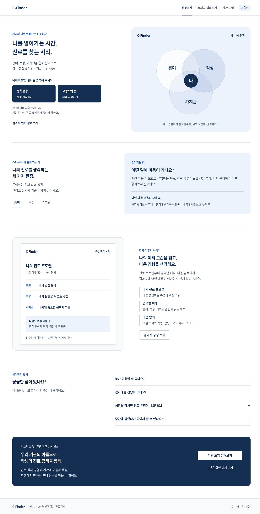

# C-Finder 1차 완료 보고

작성일: 2026-11-23

## 완료 범위

**체험용 메인 페이지와 검사 화면의 1차 구성을 완료했습니다.** HTML·CSS·JavaScript로 중학생용·고등학생용 검사 선택, 안내, 문항 응답, 검토·수정, 완료, 결과지 구성 미리보기와 기관용 화면 예시를 제공합니다.

현재 검사는 학교급별 예시 3문항입니다. 공식 문항·채점·개인 진로 유형, 서버 저장, 기관 관리자 기능은 다음 개발 범위입니다. 공개 사이트의 배포 완료는 이 보고의 확인 범위에 포함하지 않습니다.

## 화면 개선

| 영역 | 반영 내용 |
| --- | --- |
| 메인 | 학교급별 검사 시작 버튼을 첫 화면에 배치하고 흥미·적성·가치관 소개 탭, 결과지 미리보기, 자주 묻는 질문, 기관 도입 안내를 연결했습니다. |
| 공통 글씨 | 큰 제목을 줄이고 본문·설명·버튼·메뉴에 공통 글씨 기준을 적용했습니다. 모바일에서도 보조 문구를 12~13px로 줄이지 않습니다. |
| 문항 응답 | 선택지 사이 간격을 정리하고 문항·도움말·진행률의 위계를 맞췄습니다. 선택지 전체를 누를 수 있고 키보드 라디오 선택을 지원합니다. |
| 응답 검토 | 모바일에서 질문과 선택한 답이 전체 너비를 사용하도록 배치했습니다. 수정 버튼은 별도 행에 두고 조작 영역을 확보했습니다. |
| 완료 | 버튼의 화면 순서와 키보드 이동 순서를 맞추고 설명 문단의 가운데 정렬을 보정했습니다. |
| 결과지 구성 | 모바일 안내 영역을 한 열로 정리하고 별도 C 심볼과 점수가 없는 장식 막대를 제거했습니다. |
| 기관 도입 | 기관별 이름·색상·안내 문구의 예시와 도입 시 정할 운영 범위를 설명하도록 문구를 다듬었습니다. |

### 글씨 기준

공통 글씨는 `rem` 단위로 관리합니다. 아래 수치는 브라우저 기본 글씨 16px일 때의 환산값입니다.

| 용도 | 데스크톱 | 모바일 620px 이하 | 모바일 360px 이하 |
| --- | --- | --- | --- |
| 메인 제목 | 30px | 26px | 24px |
| 페이지 제목 | 28px | 24px | 22px |
| 검사 문항 | 24px | 22px | 22px |
| 구역 제목 | 22px | 20px | 20px |
| 본문·일반 설명 | 15~16px | 15~16px | 15~16px |
| 보조 문구·상태 | 14px | 14px | 14px |

기본 본문 줄간격은 1.75로 두고, 주요 설명에는 1.8~1.85를 적용했습니다. 수정·이어하기·응답 내용 펼침 등 주요 보조 조작은 최소 44px 높이를 확보했습니다.

## 확인한 항목

| 구분 | 확인 결과 |
| --- | --- |
| 정적 검사 | `npm run check`에서 JavaScript 14개 파일, 상대 경로 모듈과 진입 자산 연결을 확인했습니다. |
| 자동 테스트 | `npm test`의 상태·저장·결과 경계 테스트 25개가 통과했습니다. |
| 데스크톱 | 로컬 Chromium의 메인·결과지 구성·기관 도입 화면에서 가로 넘침과 글씨 크기를 확인했습니다. 1440px 프레임에서 검사 안내·문항·완료 화면을 확인했고, 완료 설명의 가운데 정렬도 일치했습니다. |
| 좁은 화면 | 320px 프레임의 메인·결과지 구성·기관 도입·검사 안내·문항 응답·응답 검토·완료에서 가로 넘침이 없고 글씨가 최소 14px임을 확인했습니다. 390px 프레임의 고등학생용 문항·검토·완료 화면도 확인했습니다. |
| 검사 흐름 | 키보드로 라디오를 선택하고 중학생용 예시 3문항의 응답·검토·수정·완료를 확인했습니다. 고등학생용도 3문항 응답부터 완료까지 확인했습니다. |
| 다시 시작 | 320px 프레임에서 팝업과 48px 높이의 버튼을 확인했습니다. 취소 시 완료 상태를 유지하고, 새로 시작하면 안내로 돌아가며 응답이 초기화되는 것을 확인했습니다. |
| 기관 예시 | 390·900px 프레임에서 기관용 메인을, 900px에서 결과지 구성·기관 도입 화면을 확인했습니다. 기관 브랜딩을 적용해도 글씨와 레이아웃 기준을 유지합니다. |
| 기존 흐름 확인 | 앞선 검증에서 새로고침·이어하기·응답 수정·완료, 중·고등학생용 검사 흐름과 기관 예시 테마를 확인했습니다. |

화면 크기 확인은 브라우저 프레임을 이용했습니다. 실제 휴대전화, 다른 브라우저와 공개 배포 주소는 별도 확인 대상입니다. 실행 방법은 [README](../README.md#실행)를 참고합니다.

## 다음 단계

다음 작업은 승인된 검사 자료를 실제 응답·채점·결과 흐름에 연결하는 것입니다. 학교급별 문항과 응답 척도, 문항 버전, 요인 매핑, 역채점, 동점·결측 처리, 해석·추천 자료와 검증용 기대 결과를 먼저 확정합니다.

이 자료를 기준으로 서버의 응답 저장·검증과 결과 API를 구현하고, 같은 입력에서 승인된 결과가 재현되는지 확인합니다. 기관 배포와 담당자 권한, 집단 보고서는 그 결과 계약을 공유하는 후속 범위로 진행합니다.

- [개발 순서와 완료 조건](roadmap.md)
- [검사 데이터·결과 계약](assessment-contract.md)
- [개발 구조와 배포 확인 항목](architecture.md)
